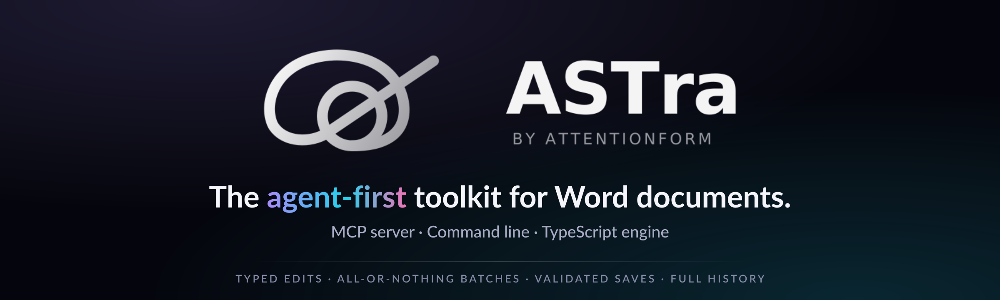

<p align="center">
  <a href="https://attentionform.com"></a>
</p>

<p align="center">
  <strong>The website for ASTra.</strong><br />
  Every number, tool name and demo on it comes from the real packages, so what it shows is what ASTra does.
</p>

<p align="center">
  <a href="https://attentionform.com"></a>
  <a href="https://github.com/Attentionform/astra"></a>
  <a href="https://discord.gg/YmJrmXUNF"></a>
  <a href="LICENSE"></a>
</p>

<p align="center">
  <a href="#whats-on-the-site">On the site</a> &nbsp;·&nbsp;
  <a href="#run-it-locally">Run it locally</a> &nbsp;·&nbsp;
  <a href="#facts-come-from-the-code">Facts</a> &nbsp;·&nbsp;
  <a href="#commands">Commands</a> &nbsp;·&nbsp;
  <a href="#layout">Layout</a> &nbsp;·&nbsp;
  <a href="#contributing">Contributing</a> &nbsp;·&nbsp;
  <a href="#license">License</a>
</p>

## What's on the site

| Page | What it shows |
|---|---|
| **Home** (`/`) | What ASTra is for, a demo with four real sessions (build a report, edit it later, send a bad edit, break a batch), and a gallery of documents an agent built |
| **How it works** (`/how-it-works`) | The outline an agent reads instead of XML, all-or-nothing batches, validation before every save, revision history, the folder an agent may touch, and how it checks its own pages |
| **Connect** (`/connect`) | Setup for Claude Desktop, Cursor, Windsurf, Claude Code, any other MCP client, the command line and your own Node code |
| **Docs** (`/docs/concepts`, `/docs/cli`) | The ideas behind the engine, and every `astra` command with its usage and an example |
| **Contact** (`/contact`) | Where to reach the team |

The site also serves two files for agents: `/llms.txt`, a plain-text summary, and `/tools.json`, a machine-readable list of the MCP server's tools. Both are built from the same facts as the pages.

It is a static site: Astro, React islands for the demos, Tailwind 4, deployed to Cloudflare. No database and no server code. `npm run build` produces plain files in `dist/`.

## Run it locally

```bash
npm install
npm run dev
```

The dev server opens on http://localhost:4321. `npm run build` makes the production files, and `npm run preview` builds and then serves them the way Cloudflare does.

## Facts come from the code

**Never type a fact into a page.** Package names, versions, tool and operation counts, CLI commands and the template gallery result all come from `src/data/site-facts.json`. The demo sessions and the showcase documents are produced the same way. Scripts run the built packages from the main repository, talk to the real MCP server and CLI, and write the result into this repository. Run them after the packages change and commit what they write.

| Script | Writes |
|---|---|
| `npm run facts` | `src/data/site-facts.json`: names, versions, counts, commands |
| `npm run demo` | `src/data/demo-session.json` and `public/demo/*.webp`: the four home-page sessions, recorded from `demo-src/` |
| `node scripts/gen-showcase.mjs` | `src/data/showcase.json` and `public/showcase/*.webp`: the gallery documents, built from `showcase-src/` |
| `scripts/gen-og.sh` | `public/og/default.png`, the social card (needs ImageMagick) |

Set `ASTRA_REPO=/path/to/astra` to point the scripts at a built checkout of the [ASTra repository](https://github.com/Attentionform/astra). Without it they look in the folder above this one, which is right only when this folder sits inside that repository. The repository location and organization name live in `src/site.config.ts`.

## Commands

| Command | What it does |
|---|---|
| `npm run dev` | Dev server on http://localhost:4321 |
| `npm run build` | Static build into `dist/` |
| `npm run preview` | Build, then serve with `wrangler dev` |
| `npm run check` | Type-check Astro and TypeScript |
| `npm run lint` | oxlint |
| `npm run facts` | Regenerate the facts file (see above) |
| `npm run demo` | Re-record the home-page demo (see above) |
| `npm run deploy` | Build and deploy to Cloudflare (maintainers only) |

## Layout

- `src/pages` routes, `src/layouts/Base.astro` page shell, `src/components` shared parts
- `src/data` generated facts, demo and showcase data, plus the short tool, operation and command summaries
- `src/styles/global.css` theme tokens (dark default, light, OS-aware). Green and red mean "validator passed" and "validator refused" only.
- `demo-src`, `showcase-src` the source documents the scripts turn into the demo and gallery
- `public/logos` shipped logo files; `brand/generate-package.cjs` draws an earlier version of the logo set (`node brand/generate-package.cjs [outdir]`, needs `rsvg-convert`) and is not the source of the shipped files

## Contributing

Fixes are welcome, most of all a wrong or unclear sentence in the docs, a broken link, a layout problem on a phone, or an accessibility problem. Read [CONTRIBUTING.md](CONTRIBUTING.md) first. For the ASTra engine, command line and MCP server, use the [ASTra repository](https://github.com/Attentionform/astra).

## License

The source code is under the [MIT License](LICENSE). The names, logos, page text, images and sample documents are not: they stay with Attentionform, all rights reserved, as the second half of the license file says. If you build a site from this code, use your own.

Copyright 2026 Attentionform, operated by the holder of the GitHub account github.com/Userfrom1995 and also identified by the GitHub organization github.com/Attentionform. Fonts and other packages keep their own licenses.
